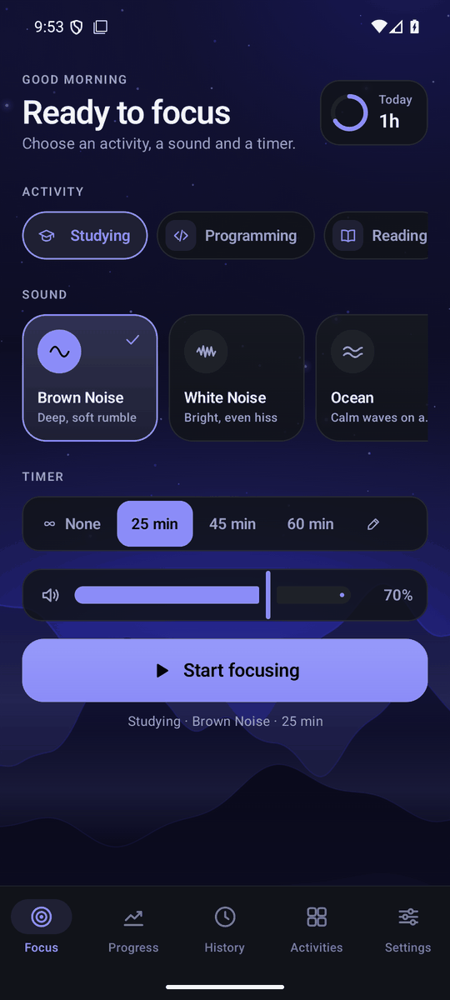
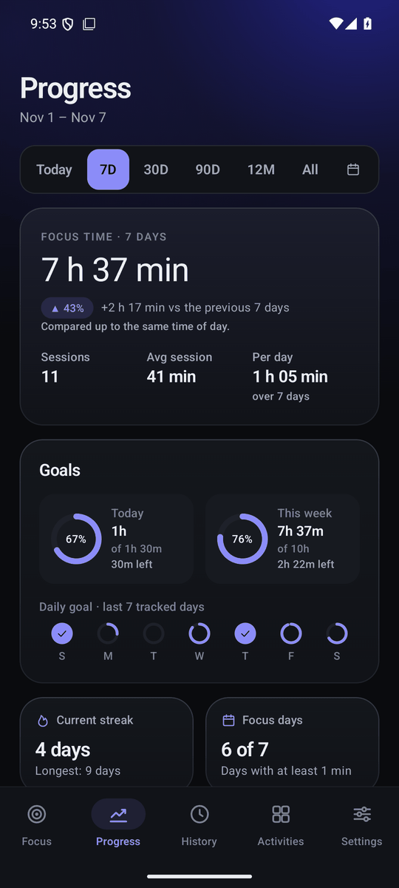
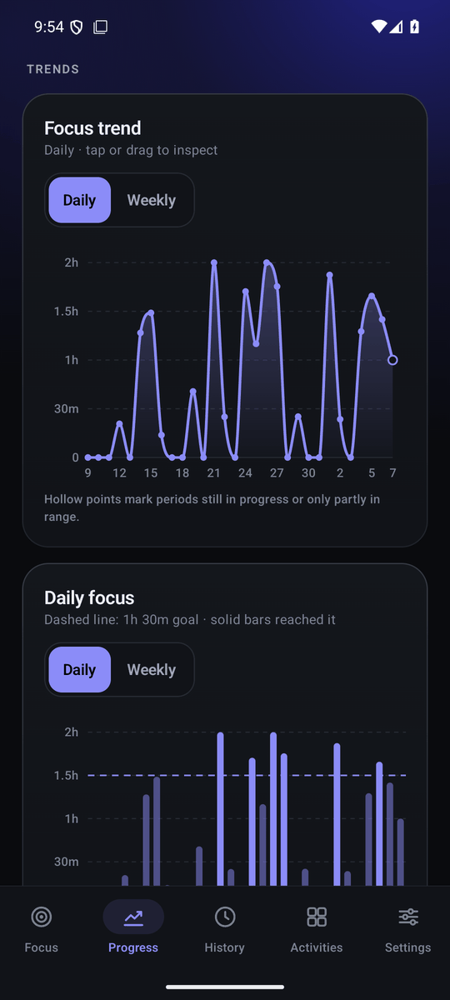
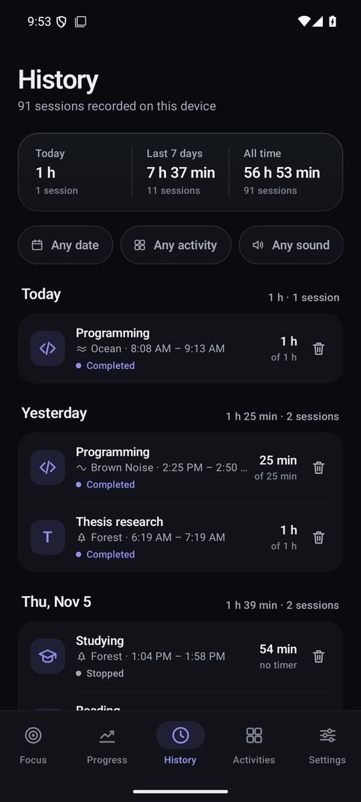

# Focus Sounds (Android)

A native Android app that plays one calm background sound while you study, code, read or work,
records every focus session on the device, and turns that history into a progress dashboard.

<p>
  
  
  
  
</p>

<sub>Emulator screenshots with demo data seeded by `tools/seed_emulator_demo.py`.</sub>

**Fully offline:** no account, backend, API key, analytics, cloud sync or network permission.
Version 2.0.0.

## Why

Many focus-sound apps need an account or a network connection. Focus Sounds does one thing
offline: start a calm, gaplessly looping sound with a timer, and show accurate statistics about
how much you actually focused (paused and interrupted time is never counted).

## Features

- **Focus:** pick an activity, one of five sounds (Brown Noise, White Noise, Ocean, Stream, Forest)
  and a timer (none, 25/45/60 min or custom). Optional start countdown, completion chime and vibration.
- **Background playback:** Media3 `MediaSessionService` foreground service with notification,
  lock-screen and headset controls; correct audio-focus handling for calls, alarms and unplugged headphones.
- **Progress dashboard:** Today / 7D / 30D / 90D / 12M / All / custom range; focus time with
  period comparison, daily and weekly goal rings, streaks, deterministic insights, and charts
  (trend, goal bars, activity donut, calendar heatmap, sound usage, session-length and start-hour
  distributions), all drawn with Compose Canvas.
- **History:** every session, grouped by day, with filters and confirmed delete.
- **Activities:** built-in and custom activities with rename/delete (history keeps its names).
- **Settings:** accent color (HSV picker, HEX, presets) with WCAG-contrast-safe derivation,
  animation intensity, goals, CSV export via the system file picker, clear history.
- **Privacy:** data never leaves the device; cloud backup and device transfer are disabled.

The exact rules (what counts as focus time, day attribution, streaks, comparisons, audio focus,
crash recovery) are documented in [docs/HOW_IT_WORKS.md](docs/HOW_IT_WORKS.md).

## Tech stack

Kotlin 2.4.21 · Jetpack Compose (BOM 2026.09.00, Material 3) · Media3 / ExoPlayer 1.11.1 ·
Room 2.8.5 (KSP) · Kotlin coroutines 1.11.0 · AGP 9.4.1 · Gradle 9.8.1 (wrapper).
compileSdk 37, targetSdk 36, minSdk 29 (Android 10).

## Architecture

```
core/   Pure Kotlin, no Android dependencies: SessionEngine (session state machine),
        ProgressAnalytics (statistics, chart data, streaks, goals, insights), ColorMath
        (HEX/HSV, WCAG contrast, accent palette), duration and CSV formatting. Unit-tested on the JVM.
app/    Android: Room data layer, SharedPreferences settings, PlaybackService (Media3 + ExoPlayer),
        completion chime/vibration, Compose UI (theme, components, chart library, screens).
tools/  Python scripts that reproducibly generate/rebuild the audio assets, an adb helper,
        and emulator-only demo-data seeding.
docs/   HOW_IT_WORKS.md (behavior and rules), SOUND_LICENSES.md (audio license manifest), images.
```

Keeping the logic in `core/` means the session rules and analytics are tested without a device
and could be reused by another front end.

## Requirements

- JDK 21 (Temurin was used; sources target Java 17)
- Android SDK with platform 37 (set `sdk.dir` in `local.properties` or `ANDROID_HOME`)
- An Android 10+ device or emulator to run the app

## Build and install

```sh
./gradlew assembleDebug                                   # Windows: .\gradlew assembleDebug
adb install -r app/build/outputs/apk/debug/app-debug.apk
```

`./gradlew assembleRelease` produces an **unsigned** APK
(`app/build/outputs/apk/release/app-release-unsigned.apk`); the repository has no signing
configuration, so sign it with your own key (`apksigner`) before installing.

Note: about 46 MB of the repository is the six lossless FLAC sound loops in
`app/src/main/assets/sounds/` (stored uncompressed in the APK for direct seeking), so clones and
APKs are large (release APK ~74 MB, unminified).

## Download

There is no published APK yet. Build from source with the commands above.

## Tests

```sh
./gradlew :core:test testDebugUnitTest lintDebug
```

- **57 JVM unit tests** in `core/` (SessionEngine 16, ProgressAnalytics 28, ColorAndFormat 13),
  all passing. Android lint: 0 errors.
- **41 instrumented tests** in `app/src/androidTest` (database, UI flows, settings/data, large-font
  rendering, backdrop contrast, on-device playback timing and sound assets). They need a device or
  emulator: `./gradlew :app:connectedDebugAndroidTest`. They use a separate `_test` database and
  preference files, so they never touch real history. The playback-timing tests assume a responsive
  device and can miss their timing windows on a heavily loaded emulator.

CI (GitHub Actions, `.github/workflows/ci.yml`) runs the JVM tests and lint on every push and pull request.

## Sound licensing

All bundled audio is either generated by this project (Brown Noise, White Noise, the completion
chime) or built from **CC0 1.0** Freesound recordings (Ocean, Stream, Forest). Sources, creators,
SHA-256 hashes and the exact sections used are listed in
[docs/SOUND_LICENSES.md](docs/SOUND_LICENSES.md). To regenerate:

- `python tools/generate_noise.py` (noise loops)
- `python tools/build_recordings.py` (Ocean, Stream, Forest from the hash-verified CC0 sources)
- `python tools/generate_chime.py` (completion chime)

## Known limitations

- Audio focus is cooperative on Android: apps that ignore it can still play over Focus Sounds.
- Aggressive OEM battery savers can stop background apps; the session is then recorded as
  interrupted at its last 15-second checkpoint.
- The Ocean, Stream and Forest loops are built from Freesound's 192 kbps previews; the lossless
  originals require a Freesound login (see `docs/SOUND_LICENSES.md`).
- The release build is not minified and not signed in this repository.

## License

Code: [MIT](LICENSE) © 2026 fadlonerez-sketch.
Audio: project-generated sounds are covered by the same MIT license; the three recordings are
CC0 1.0 by their creators (see [docs/SOUND_LICENSES.md](docs/SOUND_LICENSES.md)).
